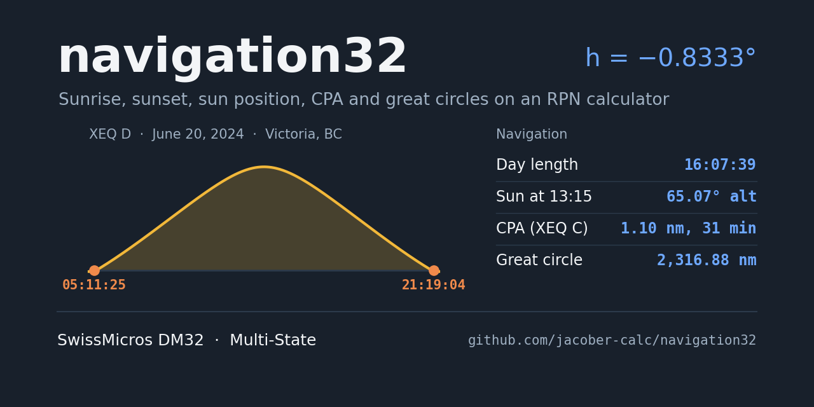
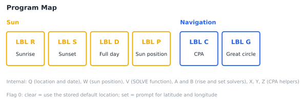
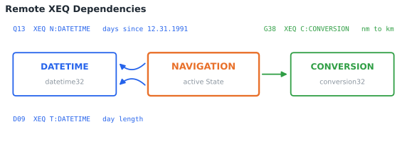
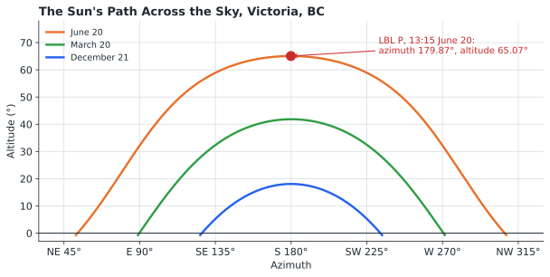
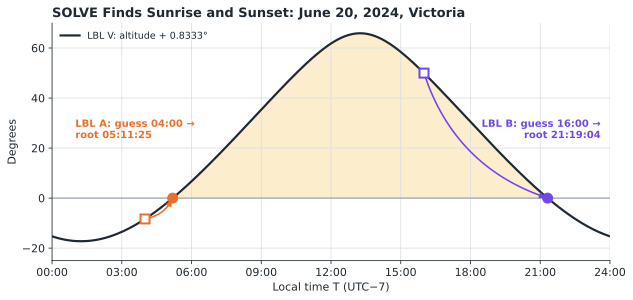
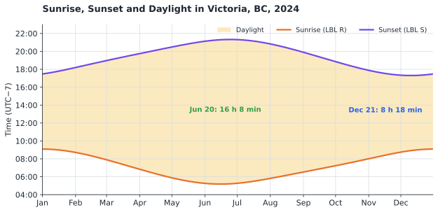
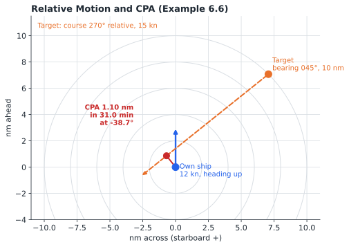
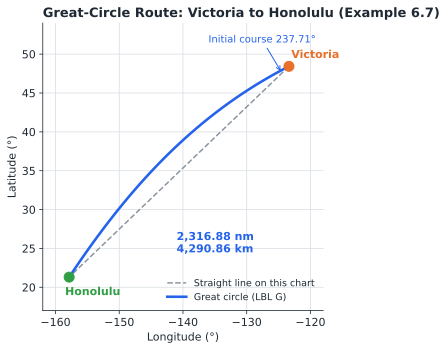

# navigation Statefile

## TABLE OF CONTENTS

1. [Introduction](#1-introduction)
2. [Theory of Operations](#2-theory-of-operations)
3. [Variable Definitions](#3-variable-definitions)
4. [Program Descriptions](#4-program-descriptions)
5. [Operating Instructions](#5-operating-instructions)
6. [Example Calculations](#6-example-calculations)
7. [Quick Reference](#7-quick-reference)
8. [Program Listing](#8-program-listing)

---

## 1. INTRODUCTION

This program suite provides celestial and marine navigation calculations for the SwissMicros DM32 calculator. It calculates sunrise, sunset, day length, and the sun's position for any date and location, solves the closest point of approach (CPA) between two vessels, and finds the great-circle distance and initial course between two positions.

### 1.1 Purpose

The program enables users to:

- Calculate sunrise and sunset times for any date
- Calculate the length of the day
- Find the sun's altitude and azimuth at any time
- Find the closest point of approach to another vessel from a single radar observation
- Calculate the great-circle distance and initial course between two positions

### 1.2 System Requirements

SwissMicros DM32 calculator with RPN operating system. Program requires 309 program steps in 14 labels. Flag 0 selects whether the program prompts for a location (section 5.2).

**This Statefile depends on two other Statefiles**, which it calls using the DM32's Remote XEQ function. Both must be loaded on the calculator:

| Statefile | Repository | Used by | For |
|-----------|------------|---------|-----|
| **DATETIME.d32** | [datetime32](https://github.com/jacober-calc/datetime32) | LBL Q, LBL D | Days between dates; day length |
| **CONVERSION.d32** | [conversion32](https://github.com/jacober-calc/conversion32) | LBL G | Nautical miles to kilometres |

Remote XEQ is a DM32 feature, so this Statefile cannot be keyed into an HP-32SII.

### 1.3 Install and Download

Copy **NAVIGATION.d32**, **DATETIME.d32**, and **CONVERSION.d32** to the `/STATE` folder of the DM32's internal USB disk. Keep the file names unchanged: the Remote XEQ instructions find the other States by name.

Load the State from the **Available States list**, not the File menu, so that its dependencies load with it:

```
1. Press [F4] to open the Available States list
2. Press the Load soft-key
3. Highlight NAVIGATION.d32 and press [ENTER]
4. When asked whether to load the dependent Statefiles, press Yes
```

DATETIME and CONVERSION are added to the Available States list and NAVIGATION is activated. Loading from the File menu does not load dependencies; any Remote XEQ to a State that is not in the Available States list stops with **NONEXISTENT**. See [Multi-State](https://technical.swissmicros.com/dm32/doc/dm32_user_manual.html) in the DM32 User Manual, sections 15.1.2 (Remote XEQ) and 20.3 (Multi-State).

### 1.4 Defaults: Location and Time Zone

The Statefile is set up for **Victoria, British Columbia** (48.4284° N, 123.3656° W) and for times in **UTC−7** (Pacific Daylight Time). Both can be changed; see sections 5.2 to 5.4.

---

## 2. THEORY OF OPERATIONS

### 2.1 Program Map



### 2.2 Remote XEQ Dependencies

Three instructions call programs in other States. When a Remote XEQ runs, the calculator activates the target State, runs the routine, and returns. The called routine sees only its own variables; the only memory shared between States is the stack and the Global registers, so all values pass on the stack.



### 2.3 The Sun's Position

LBL W calculates the sun's altitude and azimuth from the location (N, E), a day count (C), and the local time (T):

1. LBL Q obtains the number of days since December 31, 1991 by calling `XEQ N:DATETIME`, and LBL W adds the time of day converted to UTC.
2. The sun's mean anomaly grows by about 0.9856° a day from a perihelion near January 3.93, 1992.
3. Kepler's equation for the Earth's orbit (eccentricity 0.016711) is solved with the DM32's polar-to-rectangular conversions, giving the sun's ecliptic longitude.
4. A rotation by the obliquity of the ecliptic (90° − 66.5° = 23.5°) gives the sun's equatorial position.
5. The local sidereal angle gives the hour angle, and a final rotation by the latitude gives the altitude and azimuth.



### 2.4 Sunrise and Sunset

Sunrise and sunset are the moments when the centre of the sun is **0.8333° below the horizon**: 0.5667° for atmospheric refraction plus 0.2667° for the sun's semi-diameter, so that the top edge of the sun just touches the horizon. LBL V returns the sun's altitude + 0.8333°, which is zero at sunrise and sunset, and the DM32's SOLVE finds those zeros. LBL A starts SOLVE from a first guess of 04:00 and finds sunrise; LBL B starts from 16:00 and finds sunset.



Running LBL D for every day of a year traces the seasons:



**Accuracy:** Compared with the NOAA solar algorithm, sunrise and sunset times are within 50 seconds for dates from 1910 to 2099, and within 45 seconds for present-day dates. Dates are limited to the DATETIME range of March 1, 1900 to February 28, 2100.

### 2.5 Time Zone

LBL W converts local time to UTC by adding the number at line W06, which is **7** in this Statefile: all times entered and returned are UTC−7. In Victoria this matches Pacific Daylight Time; during Pacific Standard Time (UTC−8), clock times are one hour earlier than the results. For another time zone, change line W06 (section 5.4).

### 2.6 Closest Point of Approach

LBL C solves the classic radar-plotting problem in relative motion. Own ship is placed at the origin heading straight up the plot, so bearings and the target's course are entered **relative to own ship's heading**. From the target's relative position and relative velocity:

```
Time to CPA = −(D·N + E·O) ÷ (N² + O²)
```

where D and E are the target's position across and ahead of own ship, and N and O are the components of its velocity relative to own ship. The position at that time gives the CPA distance and its relative bearing.



A negative time to CPA means the CPA has already passed and the target is opening.

### 2.7 Great Circle

LBL G calculates the central angle between two positions with spherical trigonometry, using the DM32's polar-to-rectangular conversions. One minute of arc along a great circle is one nautical mile, so the angle × 60 gives the distance in nautical miles. LBL G then calls `XEQ C:CONVERSION` to convert the distance to kilometres. It also returns the initial true course.



---

## 3. VARIABLE DEFINITIONS

Variables are shared between programs; each program description in section 4 lists its inputs and outputs.

| Variable | Sun programs (R, S, D, P) | CPA (C) | Great circle (G) |
|----------|---------------------------|---------|------------------|
| **A** | Sunrise (LBL D) | | Initial course |
| **B** | Sunset (LBL D) | Relative bearing of target | |
| **C** | Days since 12.31.1991 | Target course (relative) | |
| **D** | Date (M.DDYYYY) | Target position across | Distance, nm |
| **E** | Longitude (east +, west −) | Target position ahead | End longitude |
| **N** | Latitude (north +, south −) | Relative velocity across | End latitude |
| **T** | Local time (hours) | | |
| **R** | | Range, nm | |
| **S** | Internal | Own speed, knots | |
| **V** | | Target speed, knots | |
| **X** | Internal | CPA distance, nm | Start latitude |
| **Y** | | CPA relative bearing | Start longitude |
| **Z** | Internal | Time to CPA, minutes | |
| **I, J, L, M, O** | | Internal | |

---

## 4. PROGRAM DESCRIPTIONS

### 4.1 Sun Programs

#### LBL R - Sunrise

- **Inputs:** Date (D?); latitude and longitude only if Flag 0 is set
- **Output:** Sunrise in H.MMSS (X register)

#### LBL S - Sunset

- **Inputs:** As LBL R
- **Output:** Sunset in H.MMSS (X register)

#### LBL D - Full Day

- **Inputs:** As LBL R
- **Outputs (Stack display from top to bottom):**
  - T: Date
  - Z: Day length (H.MMSS)
  - Y: Sunrise (H.MMSS)
  - X: Sunset (H.MMSS)

#### LBL P - Sun Position

- **Inputs:** As LBL R, then local time (T?) in H.MMSS
- **Outputs:**
  - Y: Altitude (degrees above the horizon)
  - X: Azimuth (degrees true)

### 4.2 Navigation Programs

#### LBL C - Closest Point of Approach

- **Inputs:** Own speed (S?), relative bearing of target (B?), range (R?), target course relative to own heading (C?), target speed (V?)
- **Outputs (Stack display from top to bottom):**
  - Z: CPA distance (nm)
  - Y: Relative bearing of CPA (−180° to +180°)
  - X: Time to CPA (minutes)

#### LBL G - Great Circle

- **Inputs:** Start latitude (X?), start longitude (Y?), end latitude (N?), end longitude (E?)
- **Outputs (Stack display from top to bottom):**
  - Z: Initial true course (degrees)
  - Y: Distance (nautical miles)
  - X: Distance (kilometres)

### 4.3 Internal Subroutines

- **LBL Q:** Loads the location and prompts for the date; calls DATETIME
- **LBL W:** Sun's altitude and azimuth
- **LBL V:** Function for SOLVE (altitude + 0.8333°)
- **LBL A, B:** Sunrise and sunset solvers
- **LBL X, Y, Z:** CPA bearing helpers

---

## 5. OPERATING INSTRUCTIONS

### 5.1 Loading the Statefile

Load NAVIGATION from the Available States list and answer **Yes** to loading dependencies (section 1.3). Check that DATETIME and CONVERSION appear in the Available States list (`[F4]`).

### 5.2 Choosing the Location (Flag 0)

- **Flag 0 clear** (default): every sun program uses the default location without prompting.
- **Flag 0 set** (`[SF] [0]`): every sun program prompts for latitude (N?) and longitude (E?). Each prompt shows the default location; press `[R/S]` to accept it, or key in a new value.

Latitudes are positive north and negative south; longitudes are positive east and negative west, in decimal degrees.

### 5.3 Changing the Default Location

The default location is stored at lines Q02 (latitude) and Q06 (longitude). To change it, for example to Seattle (47.6062, −122.3321):

```
1. In Calculator mode press [GTO] [•] [Q] 0 2       (pointer to line Q02)
2. Enter Program mode and press [←]                  (delete 48.4284)
3. Key in 47.6062                                    (inserted as the new Q02)
4. Leave Program mode, press [GTO] [•] [Q] 0 6, enter Program mode
5. Press [←], key in 122.3321 [+/-]                  (new Q06)
6. Leave Program mode
```

### 5.4 Changing the Time Zone

Line W06 holds the number of hours to add to local time to reach UTC. Replace it the same way as in section 5.3, using `[GTO] [•] [W] 0 6`:

| Time zone | UTC offset | Value at W06 |
|-----------|------------|--------------|
| Pacific Daylight (PDT) | UTC−7 | 7 (default) |
| Pacific Standard (PST) | UTC−8 | 8 |
| Eastern Standard (EST) | UTC−5 | 5 |
| Coordinated Universal | UTC | 0 |
| Central European (CET) | UTC+1 | −1 |
| Japan Standard (JST) | UTC+9 | −9 |

### 5.5 Sunrise, Sunset, and Full Day

```
1. Press [XEQ] [R] (sunrise), [XEQ] [S] (sunset), or [XEQ] [D] (full day)
2. If Flag 0 is set, answer the N? and E? prompts
3. Enter the date (M.DDYYYY) at the D? prompt and press [R/S]
```

### 5.6 Sun Position

```
1. Press [XEQ] [P]
2. Answer the location prompts (if Flag 0 is set) and the D? prompt
3. Enter the local time (H.MMSS) at the T? prompt and press [R/S]
```

### 5.7 Closest Point of Approach

```
1. Press [XEQ] [C]
2. S? own speed (knots)              [R/S]
3. B? relative bearing of target     [R/S]
4. R? range (nm)                     [R/S]
5. C? target course, relative        [R/S]
6. V? target speed (knots)           [R/S]
```

### 5.8 Great Circle

```
1. Press [XEQ] [G]
2. X? start latitude                 [R/S]
3. Y? start longitude                [R/S]
4. N? end latitude                   [R/S]
5. E? end longitude                  [R/S]
```

---

## 6. EXAMPLE CALCULATIONS

Results are shown in FIX 6, the display format saved in the Statefile. Sun programs use SOLVE, so the last digit or two of a time (fractions of a second) may differ slightly; times are quoted to the second. All times are UTC−7 and all sun examples use the default location (Victoria) unless stated.

### 6.1 Sunrise

**Problem:** When does the sun rise on June 20, 2024?

**Solution:**
```
[XEQ] [R]
D?  6.202024 [R/S]
```

**Expected Result:** 5.112473 (05:11:25)

### 6.2 Sunset

**Problem:** When does the sun set on December 21, 2024?

**Solution:**
```
[XEQ] [S]
D?  12.212024 [R/S]
```

**Expected Result:** 17.205061 (17:20:51 UTC−7, which is 16:20:51 Pacific Standard Time)

### 6.3 Full Day

**Problem:** Find sunrise, sunset, and day length for March 20, 2024.

**Solution:**
```
[XEQ] [D]
D?  3.202024 [R/S]
```

**Results (displayed on screen from top to bottom):**

| Register | Value | Meaning |
|----------|-------|---------|
| T | 3.202024 | Date |
| Z | 12.122830 | Day length, 12 h 12 min 28 s |
| Y | 7.145247 | Sunrise, 07:14:52 |
| X | 19.272077 | Sunset, 19:27:21 |

### 6.4 Another Location

**Problem:** Find sunrise and sunset in Seattle (47.6062° N, 122.3321° W) on June 20, 2024.

**Solution:**
```
[SF] [0]
[XEQ] [D]
N?  47.6062 [R/S]
E?  122.3321 [+/-] [R/S]
D?  6.202024 [R/S]
```

**Expected Results:** Sunrise 5.110520 (05:11:05), sunset 21.110750 (21:11:08), day length 16.000230 (16 h 00 min 02 s)

### 6.5 Sun Position

**Problem:** Where is the sun at 13:15 on June 20, 2024?

**Solution:**
```
[XEQ] [P]
D?  6.202024 [R/S]
T?  13.15 [R/S]
```

**Results:**

| Register | Value | Meaning |
|----------|-------|---------|
| Y | 65.071553 | Altitude, degrees |
| X | 179.869369 | Azimuth, degrees true (due south) |

### 6.6 Closest Point of Approach

**Problem:** Own ship makes 12 knots. A target bears 045° relative at 10 nm, on a course of 270° relative to own heading at 15 knots. Find the CPA.

**Solution:**
```
[XEQ] [C]
S?  12  [R/S]
B?  45  [R/S]
R?  10  [R/S]
C?  270 [R/S]
V?  15  [R/S]
```

**Results:**

| Register | Value | Meaning |
|----------|-------|---------|
| Z | 1.104315 | CPA distance, nm |
| Y | -38.659808 | CPA relative bearing (38.7° to port) |
| X | 31.043712 | Minutes to CPA |

### 6.7 Great Circle

**Problem:** Find the great-circle distance and initial course from Victoria (48.4284° N, 123.3656° W) to Honolulu (21.3069° N, 157.8583° W).

**Solution:**
```
[XEQ] [G]
X?  48.4284 [R/S]
Y?  123.3656 [+/-] [R/S]
N?  21.3069 [R/S]
E?  157.8583 [+/-] [R/S]
```

**Results:**

| Register | Value | Meaning |
|----------|-------|---------|
| Z | 237.714257 | Initial true course, degrees |
| Y | 2,316.877173 | Distance, nautical miles |
| X | 4,290.856525 | Distance, kilometres |

---

## 7. QUICK REFERENCE

### 7.1 Program Summary

| Label | Function | Prompts | Output |
|-------|----------|---------|--------|
| **R** | Sunrise | (N, E), D | X: sunrise |
| **S** | Sunset | (N, E), D | X: sunset |
| **D** | Full day | (N, E), D | T: date, Z: length, Y: sunrise, X: sunset |
| **P** | Sun position | (N, E), D, T | Y: altitude, X: azimuth |
| **C** | CPA | S, B, R, C, V | Z: distance, Y: bearing, X: minutes |
| **G** | Great circle | X, Y, N, E | Z: course, Y: nm, X: km |

(N, E) prompts appear only when Flag 0 is set.

### 7.2 Important Notes

- DATETIME and CONVERSION must be in the Available States list; otherwise the program stops with NONEXISTENT
- If an error occurs inside a called routine, the calculator is left in that State (DATETIME or CONVERSION); return to NAVIGATION with `[F4]`
- All times are UTC−7 unless line W06 is changed
- Latitudes north and longitudes east are positive; south and west are negative
- With Flag 0 clear, the default location is used every time; with Flag 0 set, each prompt starts from the default location
- Where the sun does not rise or set on the date (polar day or night), SOLVE ends with NO ROOT FND
- Dates are limited to 3.011900 through 2.282100 (the DATETIME range)
- In LBL C, bearings and the target's course are relative to own ship's heading; a negative time means the CPA has passed
- The sun programs use variables also used by LBL C and LBL G; each program prompts for or recalculates the values it needs

---

## 8. PROGRAM LISTING

The complete program listing is provided below. Program steps are shown in standard DM32 RPN format with label-relative line numbers, as displayed on the calculator. The DM32 does not generate checksums.

### LBL C - Closest Point of Approach

```
C01  LBL C             Closest point of approach (CPA).
C02  INPUT S           Own speed, knots.
C03  INPUT B           Relative bearing of target.
C04  INPUT R           Range, nm.
C05  INPUT C           Target course, relative.
C06  INPUT V           Target speed, knots.
C07  XEQ Z             Makes the bearing positive.
C08  RCL R
C09  RCL B
C10  SIN
C11  ×
C12  STO D             Target east of own ship, D.
C13  RCL R
C14  RCL B
C15  COS
C16  ×
C17  STO E             Target ahead of own ship, E.
C18  RCL V
C19  RCL C
C20  SIN
C21  ×
C22  STO L             Target velocity across, L.
C23  RCL V
C24  RCL C
C25  COS
C26  ×
C27  STO M             Target velocity along, M.
C28  RCL L
C29  STO N             Relative velocity across, N.
C30  RCL M
C31  RCL S
C32  -
C33  STO O             Relative velocity along, O = M − S.
C34  RCL D
C35  RCL N
C36  ×
C37  RCL E
C38  RCL O
C39  ×
C40  +
C41  +/-
C42  RCL N
C43  x²
C44  RCL O
C45  x²
C46  +
C47  ÷                 Time to CPA, hours:
C48  STO Z             −(D·N + E·O) ÷ (N² + O²).
C49  RCL D
C50  RCL N
C51  RCL Z
C52  ×
C53  +
C54  STO I             Across position at CPA, I.
C55  RCL E
C56  RCL O
C57  RCL Z
C58  ×
C59  +
C60  STO J             Along position at CPA, J.
C61  x≤0?              Avoids J = 0
C62  XEQ X             for the bearing.
C63  RCL I
C64  x²
C65  RCL J
C66  x²
C67  +
C68  SQRT              CPA distance.
C69  STO X             Stored in X.
C70  RCL I
C71  RCL J
C72  y,x→θ,r           Bearing of CPA.
C73  R↓
C74  STO Y             Stored in Y.
C75  RCL Z
C76  60
C77  ×                 Time to CPA, minutes.
C78  STO Z
C79  XEQ Y             Bearing to ±180.
C80  CLx               Clears stack.
C81  ENTER
C82  RCL X             Z-register: CPA distance, nm.
C83  RCL Y             Y-register: CPA bearing.
C84  RCL Z             X-register: minutes to CPA.
C85  RTN
```

### LBL X - CPA Bearing Guard

```
X01  LBL X             Nudges J above 0.
X02  1E-999
X03  +
X04  STO J
X05  RTN
```

### LBL Y - Bearing to ±180°

```
Y01  LBL Y             Bearing to −180..180.
Y02  180
Y03  RCL Y
Y04  x<y?              Below 180?
Y05  RTN
Y06  360
Y07  -                 Otherwise subtract 360.
Y08  STO Y
Y09  RTN
```

### LBL Z - Bearing to 0–360°

```
Z01  LBL Z             Bearing to 0..360.
Z02  RCL B
Z03  x>0?              Positive?
Z04  RTN
Z05  360
Z06  +                 Otherwise add 360.
Z07  STO B
Z08  RTN
```

### LBL V - Rise/Set Function for SOLVE

```
V01  LBL V             SOLVE function for rise/set.
V02  XEQ W             Sun's altitude at time T.
V03  0.8333
V04  +                 Altitude + 0.8333° (zero at rise/set).
V05  RTN
```

### LBL W - Sun Altitude and Azimuth

```
W01  LBL W             Sun's altitude and azimuth.
W02  RCL N
W03  RCL E
W04  RCL C
W05  RCL T
W06  7                 Local time + 7 = UTC (UTC−7).
W07  +
W08  STO S             Stored in S.
W09  24
W10  ÷
W11  +
W12  STO Z             Days since 12.31.1991, Z.
W13  15.218425
W14  ÷
W15  RCL+ S
W16  15
W17  ×
W18  RCL+ E
W19  98.92477
W20  +
W21  STO S             Local sidereal angle, S.
W22  -3.93
W23  RCL+ Z
W24  1.01461
W25  ÷                 Mean anomaly.
W26  ENTER
W27  ENTER
W28  0.016711          Earth's orbital eccentricity.
W29  STO X
W30  x²
W31  1
W32  -
W33  x<>y
W34  COS
W35  RCL× X
W36  1
W37  -
W38  ÷
W39  θ,r→y,x
W40  RCL- X
W41  RCL- X
W42  y,x→θ,r
W43  R↓                Solves Kepler's equation.
W44  77.2
W45  -
W46  4.647E-5
W47  RCL× Z
W48  +                 Sun's ecliptic longitude.
W49  1
W50  θ,r→y,x
W51  x<>y
W52  66.5              90° − obliquity.
W53  x<>y
W54  θ,r→y,x
W55  STO Z
W56  R↓
W57  x<>y
W58  y,x→θ,r
W59  x<>y
W60  RCL- S            Hour angle.
W61  x<>y
W62  θ,r→y,x
W63  RCL Z
W64  x<>y
W65  y,x→θ,r
W66  x<>y
W67  RCL- N            Latitude.
W68  x<>y
W69  θ,r→y,x
W70  STO Z
W71  R↓
W72  +/-
W73  y,x→θ,r
W74  R↓
W75  180
W76  x<>y
W77  -                 Azimuth.
W78  RCL Z
W79  ASIN              Altitude.
W80  RTN               X: altitude, Y: azimuth.
```

### LBL Q - Location and Date

```
Q01  LBL Q             Location and date.
Q02  48.4284           Default latitude: Victoria, BC.
Q03  STO N
Q04  FS? 0             Flag 0 set?
Q05  INPUT N           Then prompts for latitude.
Q06  -123.3656         Default longitude (west −).
Q07  STO E
Q08  FS? 0             Flag 0 set?
Q09  INPUT E           Then prompts for longitude.
Q10  INPUT D           Prompts for date, M.DDYYYY.
Q11  12.311991
Q12  x<>y
Q13  XEQ N:DATETIME    Days since 12.31.1991 (DATETIME).
Q14  STO C             Stored in C.
Q15  RTN
```

### LBL P - Sun Position

```
P01  LBL P             Sun position at a time.
P02  XEQ Q             Location and date.
P03  INPUT T           Prompts for local time, H.MMSS.
P04  →HR
P05  STO T             Stored in T, hours.
P06  RCL N
P07  RCL E
P08  RCL C
P09  RCL T
P10  XEQ W             Sun's altitude and azimuth.
P11  R↑                Clears stack.
P12  CLx
P13  R↑
P14  CLx
P15  R↑
P16  R↑
P17  x<>y              X: azimuth, Y: altitude.
P18  RTN
```

### LBL S - Sunset

```
S01  LBL S             Sunset for a date.
S02  XEQ Q             Location and date; then LBL B.
```

### LBL B - Sunset Solver

```
B01  LBL B             Sunset solver.
B02  16                First guess: 16:00.
B03  STO T
B04  FN= V             Function LBL V.
B05  SOLVE T           Solves for T.
B06  →HMS              Converts to H.MMSS.
B07  R↑                Clears stack,
B08  CLx
B09  ENTER
B10  ENTER
B11  R↑                leaving sunset in X.
B12  RTN
```

### LBL R - Sunrise

```
R01  LBL R             Sunrise for a date.
R02  XEQ Q             Location and date; then LBL A.
```

### LBL A - Sunrise Solver

```
A01  LBL A             Sunrise solver.
A02  4                 First guess: 04:00.
A03  STO T
A04  FN= V             Function LBL V.
A05  SOLVE T           Solves for T.
A06  →HMS              Converts to H.MMSS.
A07  R↑                Clears stack,
A08  CLx
A09  ENTER
A10  ENTER
A11  R↑                leaving sunrise in X.
A12  RTN
```

### LBL D - Full Day

```
D01  LBL D             Full day: rise, set, length.
D02  XEQ Q             Location and date.
D03  XEQ A             Sunrise.
D04  STO A             Stored in A.
D05  XEQ B             Sunset.
D06  STO B             Stored in B.
D07  RCL A
D08  x<>y
D09  XEQ T:DATETIME    Day length (DATETIME).
D10  RCL D             T-register: date.
D11  x<>y              Z-register: day length.
D12  RCL A             Y-register: sunrise.
D13  RCL B             X-register: sunset.
D14  RTN
```

### LBL G - Great Circle

```
G01  LBL G             Great-circle distance and course.
G02  INPUT X           Prompts for start latitude,
G03  INPUT Y           start longitude,
G04  INPUT N           end latitude,
G05  1
G06  θ,r→y,x
G07  INPUT E           end longitude.
G08  R↑
G09  -
G10  x<>y
G11  θ,r→y,x
G12  R↑
G13  x<>y
G14  y,x→θ,r
G15  x<>y
G16  RCL- X
G17  x<>y
G18  θ,r→y,x
G19  180
G20  R↓
G21  R↓
G22  +/-
G23  y,x→θ,r
G24  R↓
G25  -
G26  x<>y
G27  ACOS              Central angle.
G28  60
G29  ×                 × 60 = nautical miles.
G30  STO D             Stored in D.
G31  x<>y
G32  STO A             Initial course, A.
G33  CLx
G34  ENTER
G35  RCL A
G36  RCL D
G37  RCL D
G38  XEQ C:CONVERSION  nm to km (CONVERSION).
G39  R↑
G40  CLx
G41  R↓
G42  RTN               X: km, Y: nm, Z: course.
```

---

## Disclaimer

This program suite is provided as-is for educational and personal use. It is not a substitute for approved navigation equipment, official publications, or a proper lookout, and must not be relied on as the sole means of navigation or collision avoidance.

### By jacober-calc for SwissMicros DM32

> - [SwissMicros Website](https://www.swissmicros.com)
> - [DM32 product page](https://www.swissmicros.com/en/products/dm32)
> - [SwissMicros full products page](https://www.swissmicros.com/en/shop)
> - [DM32 Online User Manual](https://technical.swissmicros.com/dm32/doc/dm32_user_manual.html)
> - [SwissMicros Calculator Forum](https://forum.swissmicros.com/index.php)
